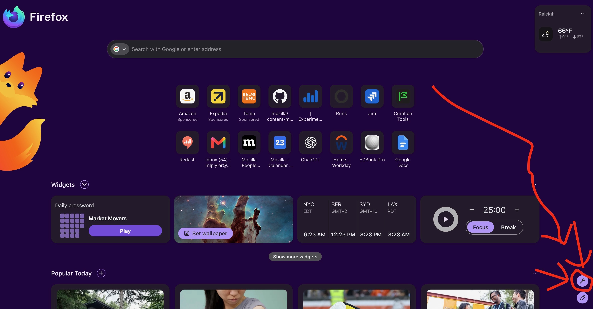
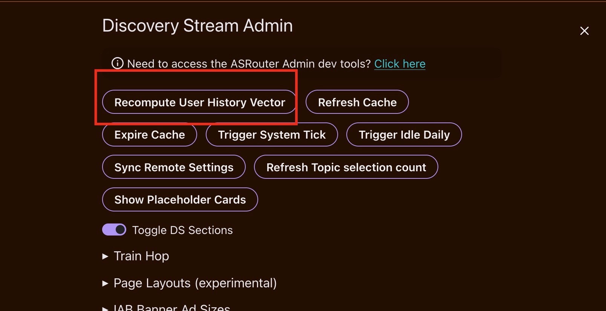
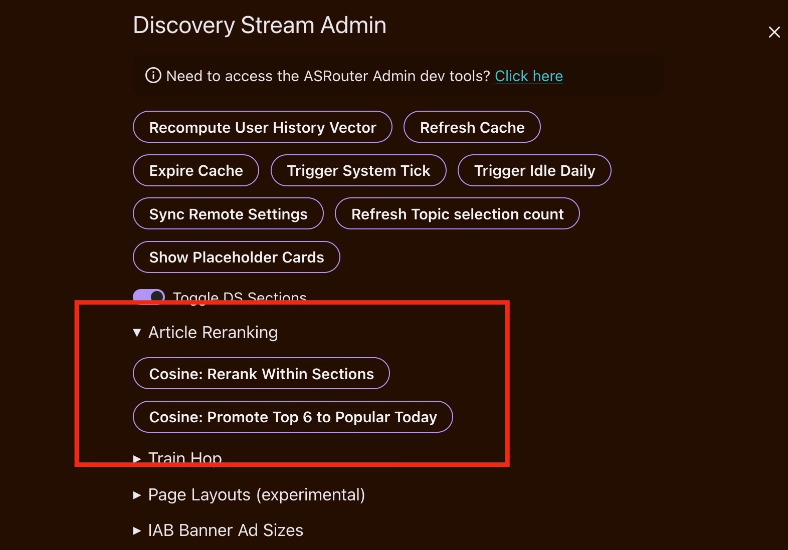

# Run History Rank

This branch is an experiment for ranking Firefox New Tab recommendations with a user-history vector. It is intended to be run from this checkout and will not be merged to `main` as-is.

The flow is:

1. Build this Firefox checkout.
2. Copy a Firefox profile with `select_profile_copy.sh`.
3. Launch the copied profile once so its `about:config` page is available.
4. Enable the required preferences in the copied profile.
5. Restart the build with the copied profile.
6. Use the New Tab devtools panel to force a vector recompute or choose a reranking mode.
7. Inspect the automatically opened HTML report and the console output.

## Build Firefox

From the repository root:

```bash
./mach bootstrap
MOZ_SKIP_PATH_PERFORMANCE_CHECK=1 ./mach build
```

`./mach bootstrap` is only needed when this checkout has not been configured yet. On later front-end-only iterations, use:

```bash
MOZ_SKIP_PATH_PERFORMANCE_CHECK=1 ./mach build faster
```

The path performance check warning is harmless. Setting `MOZ_SKIP_PATH_PERFORMANCE_CHECK=1` avoids its delay on this checkout location.

## Copy a Firefox profile

Run the interactive profile selector from the repository root:

```bash
./select_profile_copy.sh
```

The script searches in this order:

1. macOS Firefox and Firefox Nightly locations.
2. Windows Firefox locations, including Git Bash and WSL path formats.
3. Ubuntu locations, including regular, Snap, and Flatpak profiles.

It stops at the first platform where it finds profiles containing `places.sqlite`. For each profile it reports:

- the number of `moz_places` rows;
- the size of `places.sqlite`;
- the most recent history visit.

Select the profile used by the daily driver. Close the original Firefox before copying it. The script excludes profile lock files and caches from the copy.

The default destination is:

```text
~/tmp/nightly-profile-copies/
```

The script prints the exact copied profile path when it finishes.

## First launch and required preferences

Launch the copied profile once before changing preferences. This lets you open
`about:config` in the copied profile rather than editing the profile files by
hand.

Use the launch command below, replacing the profile path with the path printed
by the selector script:

```bash
MOZ_SKIP_PATH_PERFORMANCE_CHECK=1 ./mach run --noprofile -- \
  --allow-downgrade \
  -profile '/absolute/path/to/nightly-profile-YYYYMMDD-HHMMSS'
```

Open `about:config` in the copied profile and verify these values:

| Preference | Value | Purpose |
| --- | --- | --- |
| `browser.newtabpage.activity-stream.discoverystream.sections.personalization.user-history-cosine.enabled` | `true` | Enables cosine scoring, combined scoring, and article reranking. This branch defaults it to `true`. |
| `browser.newtabpage.activity-stream.discoverystream.sections.personalization.user-history-cosine.personal-weight` | `0.5` | Weight for the normalized cosine score in `combined_score`. The server score weight is `1 - personal-weight`. |
| `browser.newtabpage.activity-stream.discoverystream.sections.personalization.user-history-cosine.section-ordering.enabled` | `true` | Orders sections by the sum of their four highest article combined scores, with Popular Today always first. This branch defaults it to `true`. |
| `places.semanticHistory.featureGate` | `true` | Allows the semantic history database and user vector. Nightly normally defaults this to `true`; a profile override can still disable it. |
| `browser.ml.enable` | `true` | Allows the local embedding model to run. |
| `places.history.enabled` | `true` | Provides the browsing history and frecency data used to build the vector. |
| `browser.newtabpage.activity-stream.asrouter.devtoolsEnabled` | `true` | Shows the New Tab devtools panel and its reranking controls. |

If `places.semanticHistory.removeOnStartup` exists, it must not be `true`. Clear it or set it to `false`; otherwise the semantic database can be removed during startup.

The semantic-history manager also requires a supported region and locale, enough physical memory and CPU capacity, and a working local ML model. The current supported combinations include English in the US, Canada, Australia, the UK, Ireland, New Zealand, and the Philippines, plus English or French in France.

The profile must contain enough history for the semantic database to produce a valid, nonzero vector. The first run may need time to index history and initialize the model.

Every Merino content request from this prototype includes the fixed experiment metadata `newtab-cosine-ranking` / `all-article-server-scores`, regardless of the profile's experiment enrollment. Merino must be configured to recognize that experiment branch before it will return `server_score` for all articles.

## Restart Firefox

After changing the preferences, restart Firefox with the copied profile:

```bash
MOZ_SKIP_PATH_PERFORMANCE_CHECK=1 ./mach run --noprofile -- \
  --allow-downgrade \
  -profile '/absolute/path/to/nightly-profile-YYYYMMDD-HHMMSS'
```

`--allow-downgrade` is for the copied profile. Do not use it with the real daily-driver profile.

Keep the terminal open. Firefox console warnings and the ranking lines are printed there while the build runs.

## Use the New Tab devtools controls

1. Open a new tab.
2. Click the wrench icon in the top-right corner to open New Tab devtools.
3. Find the admin controls near the bottom of the panel.



### Recompute the user vector

Click **Recompute User History Vector**, then wait for the New Tab feed to reload.



The button forces a recompute immediately. Normal recommendation loads reuse the stored vector for the local calendar day. **Refresh Cache** reloads the recommendation data but does not force a vector recompute.

### Choose an article reranking mode

The **Article Reranking** section contains two buttons:



- **Cosine: Rerank Within Sections** is the default. It fetches a fresh recommendation response, computes `combined_score`, and sorts articles by it within each existing section. With section ordering enabled, sections are then ordered by the sum of their four highest combined scores, with Popular Today kept first.
- **Cosine: Promote Top 6 to Popular Today** fetches a fresh response, moves the six highest combined scores across the response into the first six Popular Today slots, and sorts the remaining articles within their existing sections. Section ordering follows the section-ordering pref described below.

The selected reranking mode remains active for later refreshes during the current Firefox run. Click **Cosine: Rerank Within Sections** to return to the default mode. Recomputing the user vector also returns to the default mode.

Each button triggers a fresh recommendation fetch and reranking pass.

## Open the HTML report

When a new Merino response produces at least one valid cosine score, Firefox writes and opens:

```text
newtab-history-rank.html
```

The file is stored in the running profile's local profile directory. Firefox prints the full path:

```text
[NewTab cosine] report=/path/to/profile/newtab-history-rank.html
```

For the copied-profile launch command in this guide, this is normally:

```text
/absolute/path/to/nightly-profile-YYYYMMDD-HHMMSS/newtab-history-rank.html
```

The report opens automatically in a new tab in the current Firefox window. If no browser window is available, use the path printed after `report=`. On macOS, for example:

```bash
open '/absolute/path/to/nightly-profile-YYYYMMDD-HHMMSS/newtab-history-rank.html'
```

If the console prints a different path after `report=`, use that path.

The report is one global list sorted by `combined_score`, regardless of the selected UI reranking mode. Articles without a valid combined score appear at the end. It includes combined rank, global Merino rank, combined score, cosine score, server score, section, topic, image, title, excerpt, and URL. The topic histograms compare the global Merino and combined rank distributions.

[Example HTML report](rerank_pics/rerank_report_example.html) (the checked-in snapshot predates combined scoring; newly generated reports use the columns described above.)

## Read the console ranking output

Filter the terminal or Browser Console for:

```text
[NewTab combined]
```

Successful scoring produces one line per article:

```text
[NewTab combined] section=travel original_rank=6 combined_rank=2 combined_score=0.73 cosine_score=0.91 server_score=0.55 url=https://example.com/article
```

The fields mean:

- `section`: the New Tab section containing the article;
- `original_rank`: the article's rank in the incoming feed;
- `combined_rank`: its final rank within the section after the selected reranking mode;
- `combined_score`: the score used for reranking;
- `cosine_score`: cosine similarity to the user vector;
- `server_score`: Merino's server score;
- `url`: the article URL.

`combined_score` is calculated for the complete fetched article list. Each signal is min-max normalized across the articles that have that signal, so its minimum is `0` and maximum is `1`. The score is `personal-weight * normalized cosine + (1 - personal-weight) * normalized server score`. A signal with one constant value contributes `0.5`; if one signal is missing for an article, the available normalized signal is used. Section ordering is controlled by `browser.newtabpage.activity-stream.discoverystream.sections.personalization.user-history-cosine.section-ordering.enabled`. When enabled, the section with the highest sum of its four highest finite combined scores comes first after Popular Today, followed by the other scored sections in descending sum. Sections with fewer than four scored articles use the scores they have. Sections without a finite score stay after scored sections in their original order. Within-section mode reorders articles inside their sections. Promote Top 6 moves the six global leaders into Popular Today and reorders the remaining articles inside their sections.

## Fallback messages

If semantic history is unavailable or no valid vector exists, the console shows:

```text
[NewTab cosine] no user history vector available
```

The feed then keeps its existing order and does not generate article embeddings. If a user vector exists but no article can be scored, it shows a `no article scores` message and also preserves the existing order.

## Screenshots

The screenshots used in this guide are stored in [`rerank_pics/`](rerank_pics/). Markdown renders the JPEG files inline, and the example report is linked as an HTML file.

## TODO

- Verify the Merino experiment sends `server_score` for every article and measure coverage in the client.
- Tune the default `personal-weight` and evaluate how different weights change ranking outcomes.
- Track representations of articles the user clicks in New Tab.
- Combine the history representation, the New Tab article-click representation, and `server_score` in a unified ranking strategy.
- Add client-side learning or adaptation for the three ranking signals: history similarity, article-click similarity, and `server_score`.
