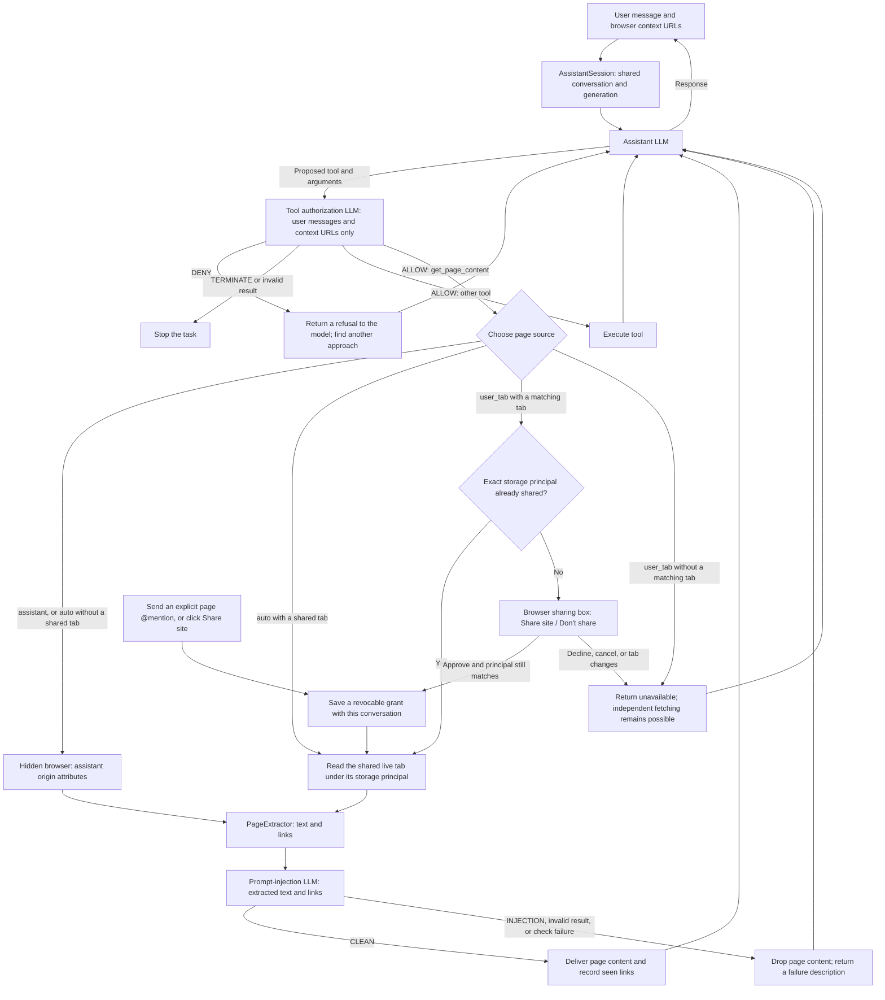

# Smart Window assistant prototype

This prototype gives Smart Window one shared assistant conversation and a browsing
identity separate from the user. It combines browser-enforced storage boundaries,
explicit access to shared tabs, and two LLM checks around tool use and page reads.

The central distinction is between **fetching a URL independently** and **reading
the user's live tab**. An unshared site can still be fetched using the assistant's
own session. Sharing grants access to the user's existing page context, including
the view produced by their signed-in session.

## Architecture



The diagram shows web-page reads. Assistant-generated `about:smartpage` documents
retain a separate internal-page read path. Page reads are authorized per URL inside
`GetPageContent`; the main chat loop avoids a duplicate authorization call for that
tool.

## Architectural decisions

### One assistant session, multiple chat views

[AssistantSession](models/AssistantSession.sys.mjs) is a parent-process singleton.
All Smart Window chat boxes use its active conversation rather than creating an
independent conversation for each tab or window. Conversation and generation events
keep the views synchronized. Selecting a conversation from history changes the
shared active conversation.

Only one generation can run at a time. A shared abort controller and turn lifecycle
prevent two chat boxes from writing concurrent assistant turns. Closing a view
does not clear the conversation or cancel its generation. An explicit new-chat
action switches every view to a fresh conversation while archiving the previous
conversation's browsing context.

This keeps conversation ownership independent of UI lifetime. Sidebar visibility,
input drafts, and model-choice overrides can still be tracked per tab.

New tabs load `about:newtab` and start with the assistant sidebar closed. Opening
the sidebar renders the existing conversation, including its messages and active
chat layout, instead of presenting a misleading fresh-chat screen.

### A separate, persistent assistant browsing identity

Each conversation uses an internal contextual identity named
`userContextIdInternal.smartWindow.<conversation ID>`. Its `userContextId` is separate from the user's
normal and container tabs. The assistant's default origin attributes include
`privateBrowsingId: 0`: an internal, non-public container is distinct from a Private
Browsing window.

The identity is applied before the hidden browser's browsing context is created.
Separate assistant fetches reuse the active conversation's identity and site storage;
they do not start with a fresh cookie jar on every request.

Starting a new chat retains the previous identity's cookies, local storage, and
cache. Selecting a chat from history reactivates its identity, visited-site
inventory, and exact principal grants in the existing assistant view. Switching
chats cancels old reads, dismisses pending consent requests, and refreshes sharing
badges. It does not open, close, navigate, or select browser tabs, change existing
context groups, or close and reopen the sidebar.

Chat renderers use a separate stable internal identity named
`userContextIdInternal.smartWindowChat`. The renderer stays mounted while chat
history changes; only tool fetches and explicitly opened context tabs use the
conversation's browsing identity. This keeps the view steady without retaining a
previous chat's browsing permissions or storage identity for new page reads.
The prototype migrates the previous global identity and versioned site inventory
to the previously active conversation when first restored.

This provides a browser storage boundary without copying the user's cookies into
the assistant's identity. It is storage isolation, not network anonymity or a
guarantee that independently fetched content is public.

Hidden page loads suppress browsing history and audio, enable tracking protection,
and restrict capabilities such as forms, popups, downloads, and storage-access
requests through sandbox flags. These restrictions remain separate from the
conversation security flags removed by this prototype.

### Page source is explicit and enforced by the browser

[GetPageContent](models/Tools.sys.mjs) accepts a `source` argument:

| Source | Behavior |
| --- | --- |
| `auto` (default) | Read an already-shared matching live tab; otherwise fetch the URL with the assistant's own origin attributes. |
| `assistant` | Fetch independently, even if a matching user tab is already shared. |
| `user_tab` | Read a matching live tab, requesting sharing consent if its principal is not already shared. |

Simply having a URL open in the browser does not make sharing a prerequisite for
fetching it. Declining a live-tab sharing request also leaves independent fetching
available. A missing live tab returns a failure for `user_tab`; it does not silently
substitute an independent fetch for the user's exact view.

Shared reads use the existing tab's `PageExtractor` actor. They do not transfer its
credentials or storage into the assistant's hidden browser. Tool results label
independent fetches and shared live-tab reads so the model can distinguish their
provenance.

`PAGE_ACCESS_INSTRUCTIONS` is appended to the normal chat system prompt by
[ChatConversation](ui/modules/ChatConversation.sys.mjs). It explains the implemented
capabilities, encourages ordinary page reads to use `auto`, and tells the model to
use the current context URL directly when available. Refreshing this prompt on
ordinary turns helps restored conversations use the current access model.

### Sharing grants a storage principal, not a URL-shaped wildcard

Sharing is keyed by the browser's `documentStoragePrincipal.origin`, including its
origin attributes. The same site in another container or storage partition remains
unshared. Within a shared principal, other matching open tabs can use the grant.

There are three ways to share:

- Send an explicit page `@` mention or an explicitly selected page-context chip.
- Click **Share site** in the assistant's page-session controls.
- Approve the sharing box raised by a `source=user_tab` request.

The automatic current-tab chip does not grant access. An unsent mention does not
grant access either. Mention-based sharing requires an open-page match resolving
to one principal; ambiguous matches across different principals do not grant
access automatically. Explicit tab-group mentions expand into member-page context
subject to the existing member limit.

The sharing box shows the exact principal, and the sidebar displays whether the
current page session is shared. Shared principals can be reviewed and revoked.
The browser rechecks the principal before applying an approval and checks the
window global around a read. Navigation cannot turn an approval for one principal
into access to another. Revocation aborts reads using that grant, and repeated
requests for the same principal are coalesced. A denial suppresses repeated
requests during the current turn.

Matching user tabs display an assistant badge with a sharing tooltip and accessible
label. The badge follows the current storage principal, including navigation,
container boundaries, newly opened tabs, and other Smart Windows. It remains
visible when the chat sidebar is closed. Revocation or switching away from the chat removes
the corresponding badges without closing user tabs.

Approved non-private storage principals persist with the conversation, including
container and partition attributes. History restoration reactivates those grants;
an unrelated conversation starts unshared. This restores permission to the user's
current matching live tab, not a historical copy of their signed-in content.
Revocations are persisted too. Pending consent requests and refusals are transient.

### Assistant browsing context is inspectable on demand

**View assistant context** opens a dedicated **Assistant context** tab group with
dotted borders. No group is created by background activity. Once opened, the group
gains a tab for each newly visited site. Each conversation has its own group.
Reopening the view reuses that conversation's group;
closing it leaves the assistant session and its site inventory intact.
Already opened groups remain untouched when switching conversations. Missing
site tabs are recreated only when explicitly viewing context or when another
page visit updates the active context view.

The inventory observes top-level HTTP(S) documents created in the assistant's
internal `userContextId`, including documents loaded from cache. Embedded frames,
scripts, pixels, background fetches, and HTTP redirect-only hosts do not become
context tabs, even if they set cookies. A site enters the list when it actually
loads as a top-level page, even if extraction fails or the injection classifier
withholds its content. This distinguishes page visits from incidental network
activity; it is not a tracker-reputation classifier. A tracking domain explicitly
opened as a top-level page still counts as a visit. Ordinary user browsing remains
excluded. Origins are deduplicated and saved in the conversation's
`assistant_context_jsonb` record alongside its identity name and sharing grants;
paths, queries, and credentials are not saved in the inventory. Older
unclassified network inventories are ignored and rebuilt from new page visits,
without resetting the chat or clearing site storage.

Context tabs use the assistant container. The first tab loads when the view opens;
additional site tabs load only when selected. Opening a site can therefore make
new requests and update its storage. This is a site inventory and a way to browse
using the assistant's identity, rather than a storage inspector. Third-party
storage can still exist and is cleared along with the assistant's other site data.
Shared user tabs stay in their original positions and are identified by their
badges and the sharing controls.

Clearing the assistant closes tabs using its browsing identity, including context
tabs moved out of the group, before clearing its site data. It also removes the
inventory and all sharing badges. The group is not saved as a saved tab group when
its window closes.

### Replace conversation flags with checks at the point of use

The runtime `SecurityProperties` model and its conversation-level flags were
removed. Permissions are now represented by concrete principal grants, while
tool necessity and page-injection checks happen at their execution boundaries.
The legacy `security_properties` persistence column remains for compatibility;
new writes store `null`, and restoring old conversations does not restore those
flags. Sharing grants are stored separately in the conversation's context record.

This avoids treating a whole conversation as permanently trusted or untrusted
after a single page read. It also keeps browser-enforced access decisions separate
from model judgments about whether an action serves the user's task.

### Authorize tools using a reduced context

[AssistantGuards](models/AssistantGuards.sys.mjs) makes a separate LLM request for
the proposed tool and all its arguments. Its context is projected from original
user-message text and browser-provided context URLs. It excludes assistant replies,
tool results, extracted pages, memories, mention labels, and injected browser
context text. The latest user message defines the task; earlier user messages can
clarify it.

The guard receives no tools. Its inference request is a network operation, but it
has no browsing or network tools with which to investigate the page itself.

| Decision | Effect |
| --- | --- |
| `ALLOW` | Continue to tool execution and any required browser permission check. |
| `DENY` | Return a tool refusal so the assistant can find another approach. |
| `TERMINATE` | Stop the task. |

Unknown responses and check failures fail closed. Guard calls have a 30-second
local timeout and participate in cancellation. The main chat loop also caps tool
iterations at 12 per turn.

### Classify extracted content before giving it to the assistant

Every non-empty `get_page_content` extraction, whether independent or shared, passes text
and links to a separate prompt-injection LLM call. That call has a fresh message
list and no tools. Only an exact `CLEAN` response allows delivery to the main
assistant and addition of the extracted links to its seen-URL set.

An injection verdict, malformed response, or check failure drops the content and
returns a failure description. This can leave the assistant free to answer using
other available information rather than terminating the whole task.

Both guard calls reuse the configured conversation engine in separate requests.
They are isolated inference contexts, not independent model providers or a proof
that content is safe.

Both model checks appear in the action log while running and update the same entry
with their verdict, failure, or cancellation. Entries persist with the conversation,
including when a guard stops the task. They record a fixed status, model metadata,
and the checked tool's identifier, without copying tool arguments, page content,
or unrecognized model output into the log.
Tool guard entries display their purpose, such as reading page content or finding
open tabs. Prompt-injection
entries explicitly report passed or failed, distinguishing detected injection
from a check error. The current action summary updates to the result when a check
finishes.

These UI-only tool-role records are excluded from the main model's wire messages,
so logging does not introduce synthetic tool replies into its conversation.

## State lifetime and clearing

| State | Lifetime and reset behavior |
| --- | --- |
| Active conversation | Shared across views; its ID is recorded in `browser.smartwindow.assistant.conversationId`, and saved messages can be restored through `ChatStore`. |
| Assistant browsing storage | Each conversation retains its internal container identity and site data across chat switches and restarts. Explicit context reset or history deletion clears it. |
| Visited-site inventory | Stored with each conversation and restored from history; context tabs appear only on request. |
| Sharing grants | Exact non-private principals persist with each conversation. They activate only for the current chat; revocation and context reset remove them. |
| Pending sharing requests | Resolve through approval or denial; cancellation and reset dismiss them. |
| Generation and reads | Shared generation controller, session lifetime, and per-grant abort controllers prevent reset or revocation from delivering stale work. |

New chat archives the previous context and starts a separate identity with no
grants or visits. Reopening history resumes that conversation's stored browser
state; cookies and cache remain subject to normal expiry and browser data clearing.

An explicit `AssistantSession.clear()` resets the active context. It immediately
cancels generation, revokes grants, aborts pending reads, and
switches the views to a new shared conversation. Its asynchronous cleanup waits
for tracked reads to settle and clears data matching the assistant's origin
attributes. New reads wait for storage clearing to finish. The user's site data
remains intact.

Resetting the assistant does not delete all archived conversations. History
deletion removes the affected conversations' retained assistant storage too,
including bulk deletion, date-range deletion, pruning, and removal of the last
message. Deleting the active conversation also resets the assistant.
Revoking sharing does not retract content already delivered into a
conversation or sent to an inference service.

## Prototype boundaries

- The tool guard removes indirectly supplied context structurally. It does not
  rewrite arbitrary quoted or pasted material inside raw user-message text; the
  guard is instructed to disregard instructions embedded in that material.
- The page classifier sees the extracted text and links, including shared private
  page content when applicable. Withholding content from the main assistant does
  not mean that no inference service received it.
- LLM judgments can produce false positives and false negatives. Storage isolation,
  principal checks, and revocation are enforced in code rather than delegated to
  those judgments.
- Tool authorization covers the main chat tool loop and the `GetPageContent`
  entry point. It is not a browser-wide policy for every AI feature or API.
- Shared access currently reads matching open tabs in Smart Windows. It does not
  install the user's principal into independent background fetches. Ordinary web
  access is limited to HTTP(S), with a separate internal generated-page exception.

## Implementation map

| Component | Responsibility |
| --- | --- |
| [AssistantSession.sys.mjs](models/AssistantSession.sys.mjs) | Shared conversation, browsing identity, generation lifecycle, grants, requests, and reset. |
| [AssistantGuards.sys.mjs](models/AssistantGuards.sys.mjs) | Tool authorization and page-injection inference calls. |
| [AssistantContext.sys.mjs](ui/modules/AssistantContext.sys.mjs) | On-demand context tab group and principal-based badges on shared user tabs. |
| [Chat.sys.mjs](models/Chat.sys.mjs) | Main tool loop, non-page tool authorization, refusal handling, and iteration limit. |
| [Tools.sys.mjs](models/Tools.sys.mjs) | Page-source selection, per-URL authorization, extraction, and content classification. |
| [AllowedURLs.sys.mjs](models/AllowedURLs.sys.mjs) | HTTP(S) protocol allowlist. |
| [ai-window.mjs](ui/components/ai-window/ai-window.mjs) | Shared chat rendering, explicit mention sharing, status indicator, and approval controls. |
| [AIWindow.sys.mjs](ui/modules/AIWindow.sys.mjs) and [AIWindowTabStatesManager.sys.mjs](ui/modules/AIWindowTabStatesManager.sys.mjs) | New-tab routing and per-tab sidebar state. |
| [ChatStore.sys.mjs](ui/modules/ChatStore.sys.mjs) and [ConversationStore.sys.mjs](ui/modules/ConversationStore.sys.mjs) | Conversation persistence and history deletion. |
| [PageExtractorParent.sys.mjs](../../../toolkit/components/pageextractor/PageExtractorParent.sys.mjs) and [HiddenFrame.sys.mjs](../../../toolkit/modules/HiddenFrame.sys.mjs) | Hidden extraction and creation of browsers with the requested origin attributes. |

## Verification

Focused coverage includes shared conversations, new tabs starting closed,
independent cookies at the same URL as a signed-in user tab, live reads after
sharing, explicit mentions, approval and denial, principal isolation, navigation
races, revocation, reset, guard failures, and model capability instructions.
Context coverage also checks redirect-only hosts, embedded requests, cached page visits, inventory
persistence, history restoration of cookies, local storage and grants without
opening context tabs, lazy context tabs, dotted group styling, and shared-tab badges across
containers and windows.

Run these commands from the repository root. The log directory must exist before
redirecting test output.

```sh
mkdir -p artifacts
./mach test browser/components/aiwindow/models/tests/xpcshell/test_AssistantSession.js browser/components/aiwindow/models/tests/xpcshell/test_AssistantGuards.js browser/components/aiwindow/models/tests/xpcshell/test_ToolDefinitions.js browser/components/aiwindow/ui/test/xpcshell/test_ChatConversation.js > artifacts/assistant-architecture-unit.log 2>&1
./mach test --headless browser/components/aiwindow/models/tests/browser/browser_assistant_session.js browser/components/aiwindow/models/tests/browser/browser_tools_get_page_content.js browser/components/aiwindow/ui/test/browser/browser_assistant_context.js browser/components/aiwindow/ui/test/browser/browser_assistant_page_access.js browser/components/aiwindow/ui/test/browser/browser_assistant_shared_conversation.js > artifacts/assistant-architecture-browser.log 2>&1
```
